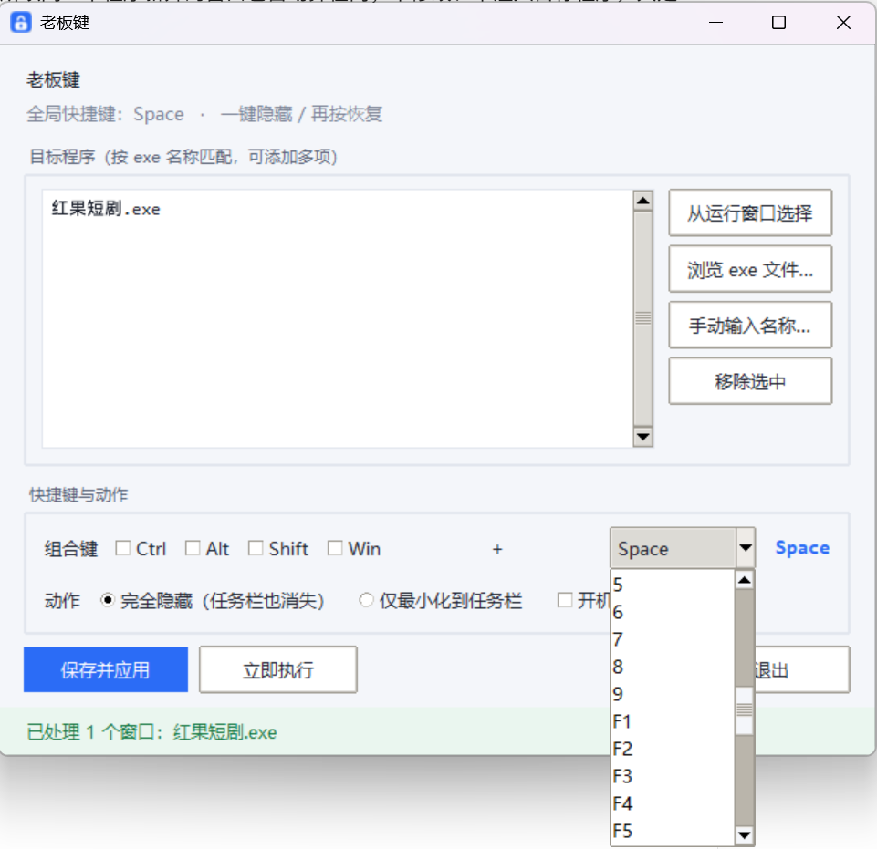

# 老板键 BossKey

> 按一下热键，指定的程序连任务栏一起消失；再按一下，原样回来。
> 一个 19 MB 的 Windows 免安装小工具，纯 Python + Win32 API，无任何第三方运行库。



## 它解决什么问题

领导/同事走到身后那一刻，你只有 1 秒。切桌面不够快，一个个点最小化更来不及。

老板键不切虚拟桌面、不隐藏窗口标题，而是直接让指定程序的窗口**从屏幕上和任务栏里一起消失** —— 就像从来没打开过。人走了再按一次，窗口回到原位、恢复置顶。

## 特性

- **一键隐藏 / 恢复**：同一个热键切换，默认 `Ctrl+Alt+Q`，可自定义任意组合
- **按 exe 匹配**：填 `chrome.exe` 就管住所有 Chrome 窗口，新开的也算，不用配窗口标题
- **两种动作**：完全隐藏（任务栏也看不见）／仅最小化到任务栏
- **多目标**：一次藏起整组程序（浏览器 + 微信 + 播放器）
- **托盘常驻**：关窗口不退出，托盘菜单可手动隐藏/恢复
- **开机自启**：勾选即写入注册表启动项，开机自动待命
- **单文件免安装**：19 MB 的 exe，拷到哪都能跑，不需要装 Python
- **安全**：不注入、不修改目标程序，只调用 Windows 自带的显示/隐藏接口；退出时自动把藏起来的窗口全部还原

## 快速开始

1. 到 [Releases](../../releases) 下载 `老板键.exe`，双击运行（首次运行图标在右下角托盘）
2. 点 **从运行窗口选择** → 勾选要藏的程序 → **添加选中**
   （也可以 **浏览 exe 文件**，或手动输入 `xxx.exe`）
3. 选好组合键 → **保存并应用**

之后随时随地按一下热键即可。

### 两种动作的区别

| 模式 | 效果 | 适合 |
|---|---|---|
| **完全隐藏**（默认） | 窗口和任务栏按钮一起消失 | 需要"秒消失"、不想留痕迹 |
| **仅最小化** | 窗口缩到任务栏 | 只想快速腾桌面，任务栏还在无所谓 |

### 几个细节

- **点 × 不退出**：窗口收起到托盘，程序继续后台待命。要退出请用托盘右键 →「退出」，或界面上的「退出」按钮。
- **托盘图标找不到？** Windows 11 默认把新图标收进任务栏的 `^` 溢出区，点开就能看到那个蓝色小锁；拖到任务栏上可以常驻。
- **配置位置**：`%APPDATA%\BossKey\config.json`，纯文本，删掉即恢复默认。
- **热键被占用？** 状态栏会红字提示"注册失败"，换一个组合即可。建议保留至少一个修饰键（Ctrl/Alt/Shift/Win）避免日常误触。
- **单实例**：重复双击只会提示"已经在运行"，不会出现两个热键打架。

## 已知限制

- 只能隐藏**普通桌面窗口**。独占全屏游戏、带反作弊保护的程序、会立刻自我重建窗口的软件可能不生效。
- 极少数程序（如某些 UWP 应用）被隐藏后可能不响应恢复，重新点开任务栏图标即可。

## 从源码运行 / 打包

需要 Windows + Python 3.12（自带 tkinter 的官方安装包）。

```bat
pip install pystray pillow pyinstaller
python bosskey.py            :: 直接运行
build.bat                    :: 或打包成单文件 exe
```

自测脚本：

```bat
python test_core.py   :: 枚举窗口 / 隐藏 / 恢复 / 热键注册
python test_e2e.py    :: 模拟真实按键，端到端验证隐藏与恢复
```

## 项目结构

```
bosskey.py        # 全部源码，单文件（ctypes 调 Win32 + tkinter 界面）
bosskey.ico       # 图标
build.bat         # 一键打包
test_core.py      # 核心逻辑自测
test_e2e.py       # 端到端按键测试
assets/           # 截图
docs/使用说明.md   # 详细说明
```

## 实现要点

- 全局热键：`RegisterHotKey(NULL, ...)` 注册在线程消息队列上，独立线程跑 `GetMessage` 循环；改热键时用 `PostThreadMessage(WM_APP+1)` 唤醒重注册。
- 窗口枚举：`EnumWindows` + `GetWindowLongW(GWL_EXSTYLE)` 过滤 `WS_EX_TOOLWINDOW`，再用 `DwmGetWindowAttribute(DWMWA_CLOAKED)` 排除 UWP 隐形窗口。
- 隐藏/恢复：`ShowWindow(SW_HIDE)`，恢复时按 `IsIconic` 选择 `SW_SHOW` 或 `SW_RESTORE`，保住窗口原有最大化状态。
- 跨线程通信统一走 `queue.Queue` + `root.after()` 轮询，避免 tkinter 的非线程安全问题。

## License

[MIT](LICENSE)

---

**English**: A tiny portable Windows "boss key" utility. Press a global hotkey to make the apps you choose vanish from both screen and taskbar, press again to bring them back. Matches by executable name, single-file exe, no runtime dependencies.
